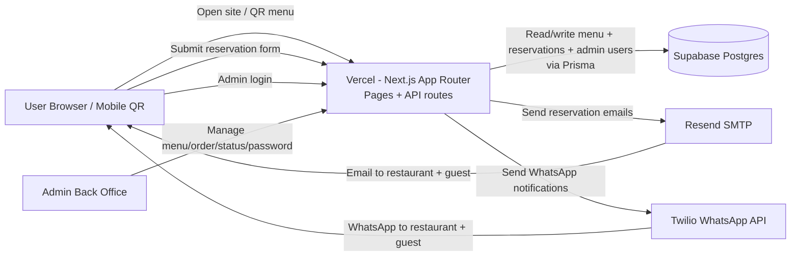

# Tláloc Restaraunt Platform

Single project architecture for:

1. QR menu for in-restaurant customers.
2. Reservation system (customer form + back office list).
3. SEO-friendly landing website.

## Run locally

```bash
npm install
cp .env.example .env.local
npm run dev
```

Open [http://localhost:3000](http://localhost:3000).

## Implemented now (MVP)

- `src/app/[locale]/menu/page.tsx`: mobile-friendly QR menu.
- `src/app/[locale]/reserve/page.tsx`: reservation form with API submission.
- `src/app/api/reservations/route.ts`: reservation GET/POST endpoints.
- `src/app/admin/page.tsx`: back-office reservations list.
- `src/app/[locale]/page.tsx`: SEO landing page entry.
- `src/app/sitemap.ts` and `src/app/robots.ts`: SEO basics.
- `src/lib/menu-data.ts`: structured menu data source for CMS migration.
- Full i18n via `next-intl` with locale routes (`/en`, `/pt`) and dictionary files (`messages/en.json`, `messages/pt.json`).
- PostgreSQL persistence via Prisma (`prisma/schema.prisma`, `src/lib/prisma.ts`).
- Reservation notification channels:
  - Email to guest + restaurant (SMTP).
  - WhatsApp to guest + restaurant (Twilio API).

## Environment setup

Copy `.env.example` to `.env.local` and add real credentials.

- Database: `DATABASE_URL`
- SMTP keys: `SMTP_*` and `RESERVATION_NOTIFY_EMAIL`
- Twilio keys: `TWILIO_*` and `WHATSAPP_NOTIFY_TO`

If keys are missing, reservations are still stored, but notification channels
return as skipped in API response.

## Database setup (Prisma + PostgreSQL)

After setting `DATABASE_URL`, run:

```bash
npm run prisma:generate
npm run prisma:migrate -- --name init
```

Optional:

```bash
npm run prisma:studio
```

## Infrastructure schema (Vercel + Supabase)



### Runtime data flow

1. User opens public pages (`/en`, `/pt`, `/menu`, `/reserve`) on Vercel.
2. Reservation form posts to `POST /api/reservations`.
3. API stores reservation in Supabase Postgres through Prisma.
4. API sends notifications through SMTP (Resend) and WhatsApp (Twilio), when configured.
5. Restaurant receives email with confirmation link (`/api/reservations/confirm?...`).
6. Link call updates reservation status to `confirmed` in Supabase.
7. Admin back office (`/admin`) reads/writes menu and reservations from the same DB.

### Environment boundaries

- **Local dev**: Next.js reads `.env`.
- **Production**: Vercel reads Environment Variables.
- **Database**:
  - `DATABASE_URL` -> pooled runtime connection
  - `DIRECT_URL` -> Prisma migrations (`prisma migrate`)

## Expansion plan

- Add database (PostgreSQL + Prisma).
- Add auth for admin routes.
- Add reservation states, availability rules, and notifications.
- Add CMS forms for menu/category/item management.
- Add multilingual fields (`en`, `pt`) in DB schema and UI.
